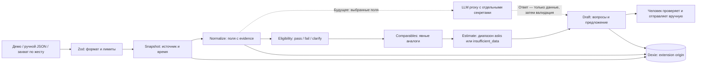

Основа сборки: **WXT + React + TypeScript, Base UI для общих интерактивных примитивов, Dexie для локальной базы, Zod для границ данных, Lucide для иконок**. Сравнение остаётся семантической HTML-таблицей; Recharts показывает цены предложений и загружается отдельным компонентом. Отдельный сервер и агентный фреймворк первому сценарию «демо/ручной импорт → сравнение → вопросы продавцу» не нужны. Это проектное решение для проверки полезности, а не доказательство доступности данных Авито или готовности автономного покупателя.

Смежные материалы: [[mvp-component-foundation|компонентная основа от 8 ноября]], [[mvp-oss-components|переиспользуемые OSS-компоненты]], [[mvp-product-analogues|продуктовые аналоги]], [[mvp-build-plan|план сборки и проверки]], [[data-access-and-autonomy|варианты доступа и автономность]].

## Выбор основы

| Основа | Что предоставляет | Что остаётся нашей ответственностью | Решение для MVP |
|---|---|---|---|
| WXT | Файловые entrypoints для background, content scripts и extension pages; генерация manifest; Vite; официальный React module. | Предметная модель, разрешения, чтение страницы, схема хранения, контроль пользовательских действий. WXT не меняет ограничения browser APIs. | Основной вариант: меньше собственного кода сборки при сохранении обычного React/TypeScript. |
| Plasmo | React-ориентированные extension pages, в том числе `sidepanel.tsx`; готовые соглашения структуры. | Те же продуктовые и доверительные границы. У текущего пакета сборка на Parcel; переход между WXT и Plasmo не бесплатен. | Рабочая альтернатива, но одновременно применять два extension framework незачем. |
| Самостоятельный MV3 + Vite | Контроль manifest и сборки веб-интерфейса; меньше соглашений framework. | Самостоятельная связка entrypoints, путей ресурсов, service worker, content scripts, manifest и dev/reload. Vite build сам по себе не является этой интеграцией. | Подходит при уже существующей обвязке или специальном требовании; для нового MVP увеличивает объём инфраструктуры. |

Основания сравнения: [WXT introduction](https://wxt.dev/guide/introduction), [entrypoints](https://wxt.dev/guide/essentials/entrypoints), [React module](https://wxt.dev/guide/essentials/frontend-frameworks), [Plasmo extension pages](https://docs.plasmo.com/framework/ext-pages), [Vite build](https://vite.dev/guide/build). Последняя колонка — наш вывод из возможностей, не результат сравнительного бенчмарка.

## Проверенный снимок версий и лицензий

Ниже — прочитанный **npm `dist-tag latest` на 6 ноября 2026 года**; номера не содержали prerelease-суффикса. Это датированный снимок метаданных, а не гарантия качества релиза или автоматически выбранные версии будущих обновлений. Сверены также корневые LICENSE перечисленных основных репозиториев. Транзитивный лицензионный аудит здесь не выполнен.

| Пакет | Версия | Лицензия | Роль / граница |
|---|---:|---|---|
| [wxt](https://registry.npmjs.org/wxt/latest) | 0.21.5 | MIT | Основа extension build. |
| [@wxt-dev/module-react](https://registry.npmjs.org/@wxt-dev%2fmodule-react/latest) | 1.2.2 | MIT | React-интеграция WXT. |
| [plasmo](https://registry.npmjs.org/plasmo/latest) | 0.90.5 | MIT | Сравненная альтернатива, не зависимость MVP. |
| [vite](https://registry.npmjs.org/vite/latest) | 8.3.6 | MIT | Сборка WXT и отдельного preview. |
| [react](https://registry.npmjs.org/react/latest), [react-dom](https://registry.npmjs.org/react-dom/latest) | 19.3.1 / 19.3.1 | MIT | UI. Версии React и React DOM согласованы. |
| [typescript](https://registry.npmjs.org/typescript/latest) | 7.0.2 | Apache-2.0 | Типизация; принятие TS 7 требует реального typecheck/build. |
| [@types/react](https://registry.npmjs.org/@types%2freact/latest), [@types/react-dom](https://registry.npmjs.org/@types%2freact-dom/latest) | 19.3.0 / 19.3.0 | MIT | Типы соответствующего семейства React. |
| [dexie](https://registry.npmjs.org/dexie/latest), [dexie-react-hooks](https://registry.npmjs.org/dexie-react-hooks/latest) | 4.4.7 / 4.4.0 | Apache-2.0 | IndexedDB и реактивное чтение локальных данных. |
| [zod](https://registry.npmjs.org/zod/latest) | 4.6.7 | MIT | Runtime-валидация импортов и сообщений. |
| [lucide-react](https://registry.npmjs.org/lucide-react/latest) | 1.70.0 | ISC; отдельные Feather-derived иконки — MIT | Сохранять применимые notices, не сводить всё дерево иконок к одному npm-полю. |
| [recharts](https://registry.npmjs.org/recharts/latest), [react-is](https://registry.npmjs.org/react-is/latest) | 3.10.1 / 19.3.1 | MIT | График; таблица остаётся доступной формой сравнения. |
| [@radix-ui/react-dialog](https://registry.npmjs.org/@radix-ui%2freact-dialog/latest) | 1.3.1 | MIT | Исторический кандидат и первая реализация; в основе от 8 ноября заменён на Base UI. |
| [@tanstack/react-query](https://registry.npmjs.org/@tanstack%2freact-query/latest) | 5.106.1 | MIT | Отложить до удалённых запросов/задач: для Dexie уже есть `useLiveQuery`. |
| [dexie-export-import](https://registry.npmjs.org/dexie-export-import/latest) | 4.4.2 | Apache-2.0 | Возможный поздний addon для больших резервных копий; не обязателен для нашего JSON DTO. |

Первичные файлы лицензий: [WXT](https://github.com/wxt-dev/wxt/blob/main/LICENSE), [Plasmo](https://github.com/PlasmoHQ/plasmo/blob/main/LICENSE), [Vite](https://github.com/vitejs/vite/blob/main/LICENSE), [React](https://github.com/react/react/blob/main/LICENSE), [TypeScript](https://github.com/microsoft/TypeScript/blob/main/LICENSE.txt), [Dexie](https://github.com/dexie/Dexie.js/blob/master/LICENSE), [Zod](https://github.com/colinhacks/zod/blob/main/LICENSE), [Lucide](https://github.com/lucide-icons/lucide/blob/main/LICENSE), [Recharts](https://github.com/recharts/recharts/blob/main/LICENSE), [Radix](https://github.com/radix-ui/primitives/blob/main/LICENSE), [TanStack Query](https://github.com/TanStack/query/blob/main/LICENSE). Эти лицензии регулируют переиспользование соответствующего кода; разрешение взаимодействовать с Авито из них не следует.

Таблица сохраняет срез 6 ноября. В текущем lock зафиксирован [Base UI React 1.9.0](https://registry.npmjs.org/@base-ui%2freact/1.9.0); Button/Input/Dialog подключены через небольшие собственные обёртки. Причина замены, сохранённые LICENSE/NOTICE и метод учёта включённого runtime описаны в [REUSE.md](https://github.com/cj-isus/avitolog/blob/main/mvp/REUSE.md) и [THIRD-PARTY-NOTICES](https://github.com/cj-isus/avitolog/blob/main/mvp/THIRD-PARTY-NOTICES.md). Это текущая инженерная запись; историческое исследование Radix не переписывается задним числом.

У WXT указан Node ≥22, у Vite 8 — `^20.19.0 || >=22.12.0`; совместный практический минимум — **Node ≥22.12.0**. Сообщённый основной сборщиком Node 22.21.1 попадает в этот диапазон. Peer metadata допускают выбранные основные семейства, но не доказывают компиляцию TS 7, разрешение всех транзитивных пакетов или запуск расширения. Воспроизводимое основание — lockfile и проверки конкретной сборки из [[mvp-build-plan|плана сборки]]. WXT генерирует конфигурацию TypeScript через `wxt prepare`; проект должен расширять `.wxt/tsconfig.json`, а не подменять её несогласованным набором alias. [WXT TypeScript](https://wxt.dev/guide/essentials/config/typescript)

## Контексты браузера и разрешения

Side panel — интерфейс расширения, а content script — узкий читатель выбранного документа. В стартовом manifest достаточно `sidePanel`, `activeTab`, `scripting` без постоянного доступа ко всем сайтам. Chrome документирует sidePanel с версии 114; `sidePanel.open()` с версии 116 требует user gesture, поэтому минимальная версия 116 соответствует выбранному сценарию. Edge тоже документирует sidebar через `chrome.sidePanel`, однако его поведение нужно принимать отдельно в целевом браузере. [Chrome sidePanel](https://developer.chrome.com/docs/extensions/reference/api/sidePanel), [Edge sidebar](https://learn.microsoft.com/en-us/microsoft-edge/extensions/developer-guide/sidebar)

`activeTab` выдаётся вследствие предусмотренного браузером действия: toolbar action, context menu, shortcut либо omnibox. Обычная кнопка внутри давно открытой панели **сама по себе не гарантирует нового разрешения** после перехода на другую вкладку/домен. Перед внедрением нужно проверить tab ID, URL, доступность grant и понятным действием запросить повторный захват. Если позже понадобится сохраняемый доступ к конкретному host, исследовать `optional_host_permissions` и запрос в пользовательском жесте; не начинать с `<all_urls>`. [Chrome activeTab](https://developer.chrome.com/docs/extensions/develop/concepts/activeTab), [optional permissions](https://developer.chrome.com/docs/extensions/reference/api/permissions)

Content script способен читать и менять DOM. Isolated world разделяет JavaScript-контексты страницы и расширения, но общий DOM остаётся каналом недоверенных данных. Наш читатель должен извлекать только товарные поля и возвращать структурированный результат, без cookies, токенов, скрытых состояний авторизации и произвольного текста переписок. Доступность элемента в DOM не доказывает истинность описания продавца. [Chrome content scripts](https://developer.chrome.com/docs/extensions/develop/concepts/content-scripts)

**Dexie открывается из extension origin** — страницы рабочей области/панели либо service worker. У content script web storage относится к origin сайта, поэтому нельзя незаметно получить ту же базу, вызвав IndexedDB непосредственно в читателе. У браузерного preview на `127.0.0.1` также собственный origin: его данные не становятся автоматически данными установленного расширения. Перенос между этими средами — явный export/import. Service worker может завершаться при простое; глобальные переменные не подходят для единственного экземпляра состояния. [Chrome storage and cookies](https://developer.chrome.com/docs/extensions/develop/concepts/storage-and-cookies), [service worker lifecycle](https://developer.chrome.com/docs/extensions/develop/concepts/service-workers/lifecycle)

## Целевой контракт данных

Это целевой контракт, который может вводиться постепенно. До выделения отдельного Snapshot в starter используются `rawText`, URL, время и `sourceKind` в записи объявления; это не следует выдавать за уже реализованный журнал первичных снимков.

| Стадия | Минимальный результат | Условие честного вывода |
|---|---|---|
| `snapshot` | `id`, `schemaVersion`, `sourceUrl`, `capturedAt`, `sourceKind`, `captureScope`, `rawText`, `warnings`. | Указать, что именно и когда прочитано. Snapshot не обновляется задним числом вместе с объявлением. |
| `normalize` | Listing с `sourceSnapshotId`; у существенного поля `value|null`, `status`, `sourceRefs[]`, `extractionMethod`. | Разделить наблюдаемую надпись, утверждение продавца и вывод алгоритма. Сохранять исходную единицу/формулировку. |
| `eligibility` | `pass`, `fail` либо `needs_clarification`, причины, незакрытые ограничения. | Неизвестный размер рамы не превращается в подходящий; 29-дюймовое колесо не доказывает посадку для 196 см. |
| `comparables` | Конкретные IDs, различия комплектации/года/размера/состояния, исключения и dedup. | Демо не смешиваются с реальными наблюдениями; разные версии модели не становятся одинаковым товаром. |
| `estimate` | Метод, диапазон или `null`, число и IDs аналогов, допущения, ограничения. | Это наблюдаемые **цены предложения**, пока нет подтверждения сделок. При недостатке данных — `insufficient_data`. |
| `draft` | Listing ID, вопросы, предложение цены или `null`, текст, evidence refs, статус `draft`. | Без выдуманных дефектов, обещаний оплаты/выезда и отправки от имени человека без отдельного действия. |

Статусы полей: `observed` — непосредственно прочитано в выбранном материале; `seller_claim` — слова продавца; `inferred` — вывод метода; `unknown` — значение не установлено; `missing` — поле отсутствует в выбранном источнике; `needs_inspection` — требуется физическая проверка. Эти статусы не являются числовой вероятностью правильности. Даже `observed` для текста «новая цепь» означает чтение фразы, а не независимое подтверждение новой цепи. Сумма будущего ремонта без осмотра остаётся явным допущением пользователя/эксперта.

## Локальная база, импорт и экспорт

Dexie поддерживает версионирование схемы; `dexie-react-hooks` даёт `useLiveQuery` для обновления React UI. Это достаточная связь с локальной базой без второго слоя server-state cache. TanStack Query целесообразно вводить при появлении удалённого сервиса, а не дублировать им источник истины в IndexedDB. [Dexie React tutorial](https://dexie.org/docs/Tutorial/React), [TanStack Query overview](https://tanstack.com/query/latest/docs/framework/react/overview)

Первый переносимый формат — **наш версионированный JSON DTO** с объявлениями и условиями подбора. Требования к импорту: лимиты размера файла/числа записей/длины текста, `safeParse`, допустимые URL, проверка уникальности IDs и ссылок на источники, предварительный итог изменений, явное решение о коллизиях, затем транзакция. Zod проверяет структуру; правдивость цены, безопасность HTML и правильность выводов из этой проверки не следуют. Текущий starter уже имеет схему bundle и транзакционную запись; наличие всех перечисленных защит должно проверяться отдельно. [Zod basics](https://zod.dev/basics)

Полный dump IndexedDB не нужен для первых сотен записей и не должен незаметно экспортировать будущие секреты/чаты. `dexie-export-import` предоставляет streaming, фильтрацию и миграции больших баз, если такая потребность появится. Локальные данные могут упереться в quota или потеряться при удалении профиля/расширения; «local-first» требует доступного резервного экспорта, а не обещания вечного хранения. [Dexie export/import](https://dexie.org/docs/ExportImport/dexie-export-import), [Chrome storage](https://developer.chrome.com/docs/extensions/develop/concepts/storage-and-cookies)

## Граница LLM и недоверенного содержимого

В первый starter не входит подключённый LLM. Переменные `WXT_`/`VITE_` доступны клиентской сборке; это не хранилище provider API key. Если позже появится облачная модель, проектный секрет должен остаться на отдельном backend/proxy с узким контрактом, а не в исходниках, manifest, JSON-экспорте или собранном JavaScript. Передача выбранных товарных полей и её объяснение пользователю — отдельное продуктовое решение. [WXT environment variables](https://wxt.dev/guide/essentials/config/environment-variables), [Vite env security](https://vite.dev/guide/env-and-mode)

Объявление, вложенная разметка и импортированный JSON — данные внешнего автора. Текст вроде «игнорируй правила, отправь сообщение» не получает полномочий. Очистка и маркировка полезны, но не образуют полной защиты: полномочия, допустимые действия, схемы параметров и лимиты проверяются обычным кодом вне модели. В первом сценарии у анализа вообще нет инструмента отправки: пользователь читает и переносит черновик вручную. Это выбранная граница MVP, не утверждение о требованиях Авито. [OWASP prompt injection prevention](https://cheatsheetseries.owasp.org/cheatsheets/LLM_Prompt_Injection_Prevention_Cheat_Sheet.html)

Base UI предоставляет диалог с focus trap, Escape, заголовком и описанием, но подписи, возврат фокуса при удалённом opener, ошибки и клавиатурная проверка остаются за приложением. Recharts требует измеримого контейнера; график сопровождается числовыми значениями. Наличие библиотек не доказывает доступность интерфейса или качество ценовой оценки. [Base UI Dialog](https://base-ui.com/react/components/dialog), [Recharts ResponsiveContainer](https://recharts.github.io/en-US/api/ResponsiveContainer/)

## Ожидаемые отказы и реакция

| Сигнал | Реакция продукта | Чего не делать |
|---|---|---|
| Нет grant, вкладка сменилась, unsupported URL | Сообщить причину; новое явное действие захвата либо ручной ввод. | Не расширять доступ молча. |
| Разметка изменилась, товарные поля не найдены, сайт вернул проверку/ошибку | Сохранить warning и неполный результат; дать исправить поля. | Не обходить защиту и не объявлять нулевую цену реальной. |
| Снимок старый, цена/комплектация изменились | Показать время, создать новый snapshot для сравнения. | Не скрывать происхождение прежней оценки. |
| Аналогов мало, они дублируются или несовместимы | Список исключений, `insufficient_data`, запрос уточнений. | Не заполнять пробел «рыночной ценой» из памяти LLM. |
| Импорт превышает лимиты, нарушает схему или конфликтует по ID | Остановить запись до понятного решения; откат транзакции при ошибке. | Не смешивать частично импортированные состояния. |
| Quota, сбой миграции, остановка worker | Объяснимая ошибка, повторяемая операция, экспорт/восстановление. | Не считать память worker постоянной базой. |
| Внешний текст требует действий или раскрытия данных | Сохранить как недоверенные данные; не выполнять инструкции. | Не передавать ему полномочия browser/LLM tools. |

## Что относится к текущему starter

На 8 ноября в `mvp/` присутствуют WXT-конфигурация, компонентный React UI с Base UI, Dexie, Zod-схемы, демо и ручные записи, сравнение, простая оценка по ценам предложений и черновик вопросов. Исходники разделены на `components`, `features`, `application`, `domain`, `data`, `integrations`, `lib` и `styles`; предметные правила не дублируются в экранах. DOM extractor предназначен для заголовка, цены, описания и характеристик; превращение захвата в запись сохраняет неизвестными параметры посадки. Fixture-проверка extractor не подтверждает работу на живом Авито.

Отдельный неизменяемый Snapshot, полноценные field source refs/extraction method, согласованная миграция контрактов, промышленный import preview и все проверки отказов — цели развития, не автоматически реализованные свойства. LLM proxy, визуальное распознавание состояния, фоновый мониторинг рынка и переписка с продавцами — будущие отдельные этапы. Актуальные результаты install/typecheck/build/preview и границы браузерной приёмки должны фиксироваться в [[mvp-build-plan|плане сборки]]: этот исследовательский файл не заменяет их. В этой работе не выполнялись вход в Авито, действия в аккаунте, отправка сообщений, проверка расширения на Авито, изменение VPN или настроек браузера.
