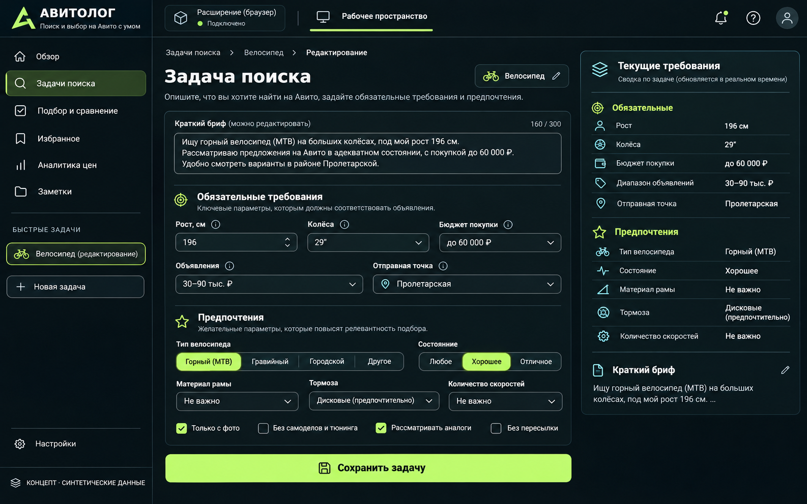
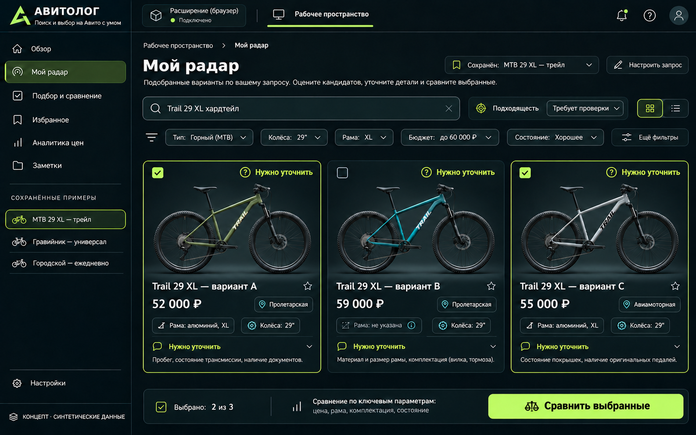
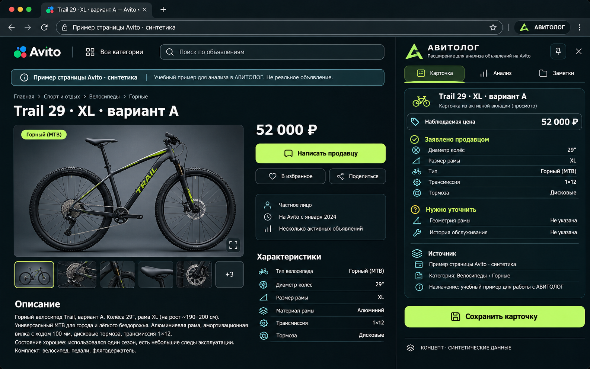
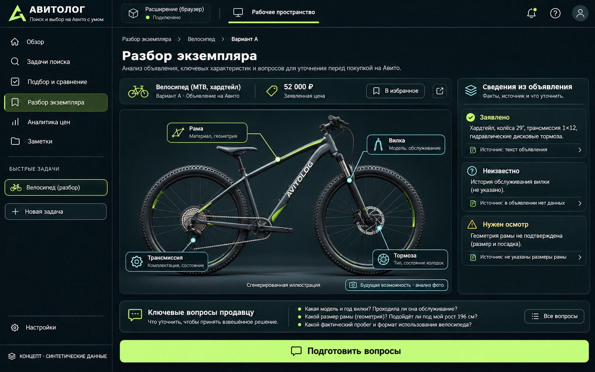
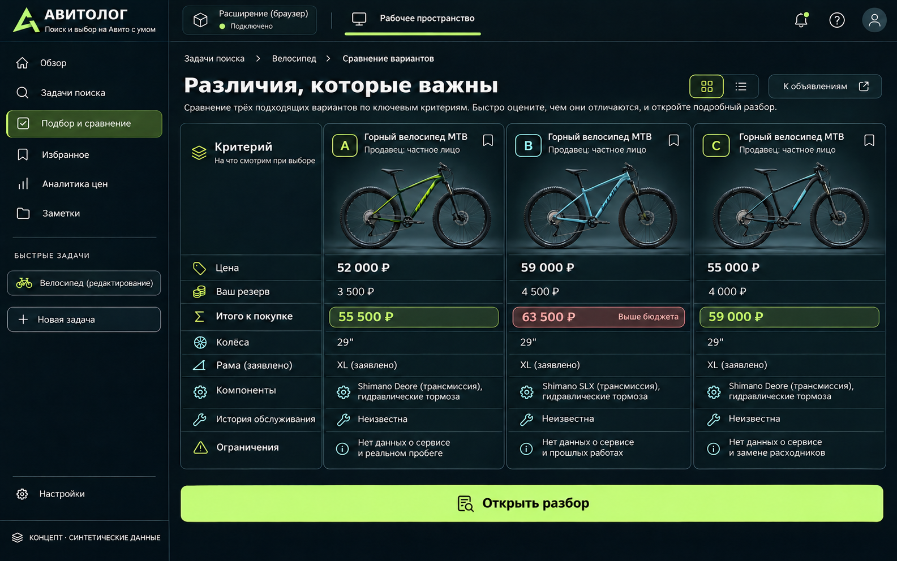
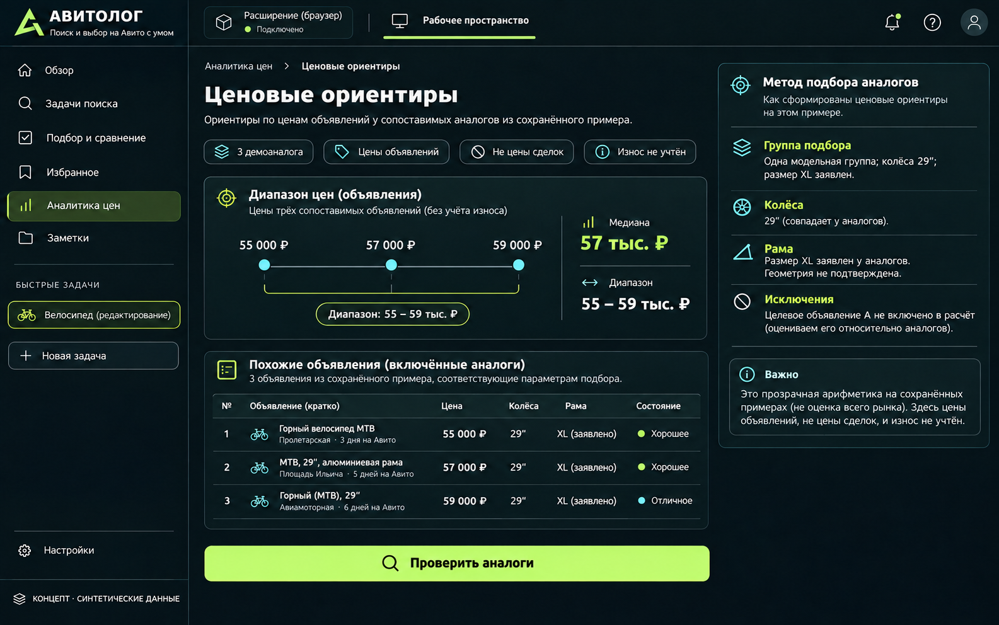
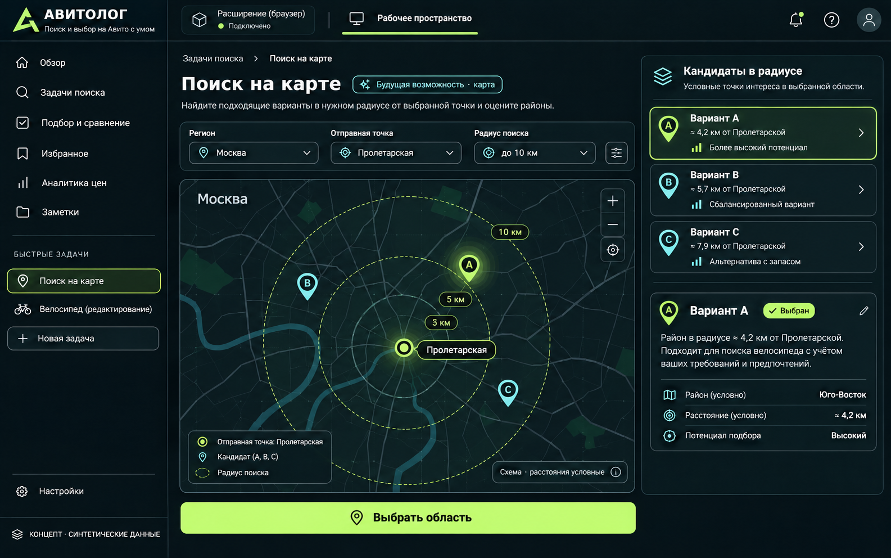
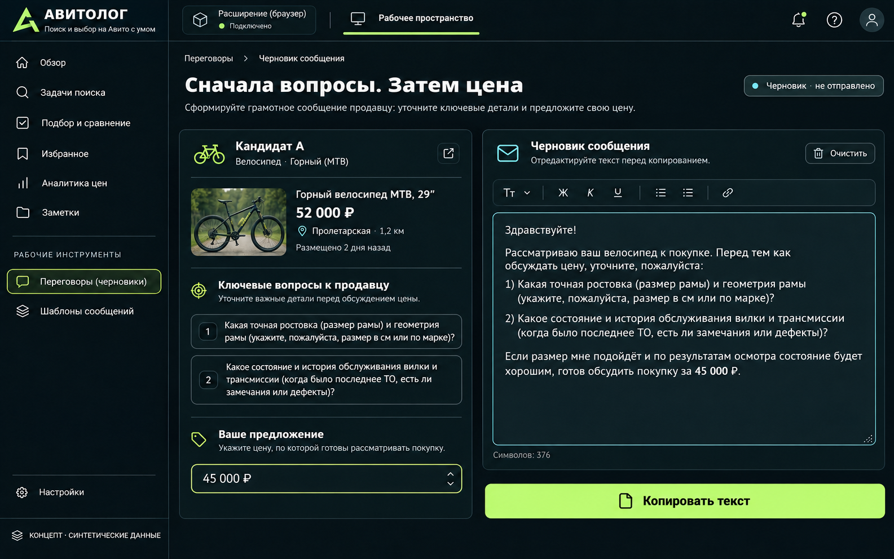
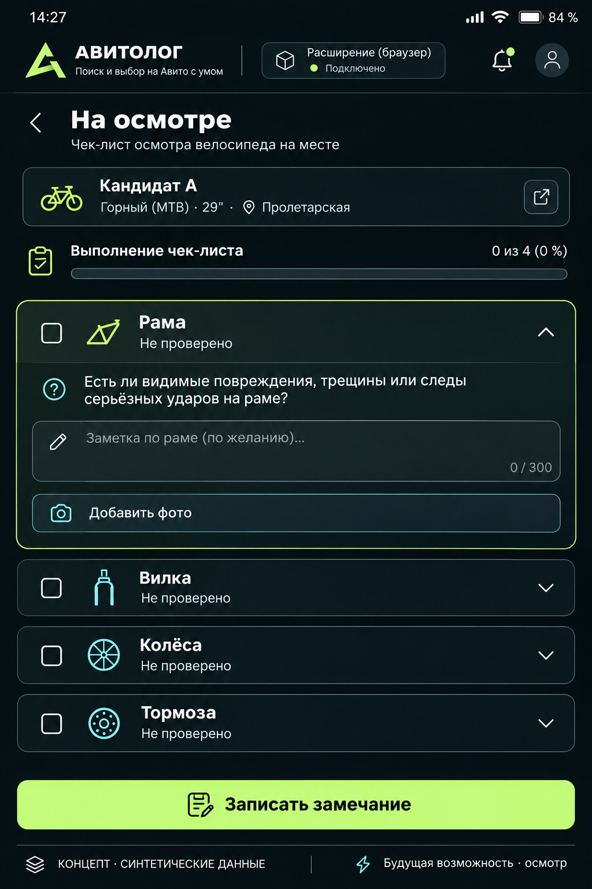
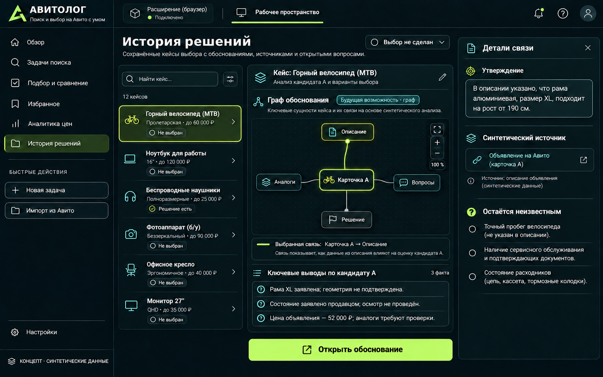

# АВИТОЛОГ: десять экранов будущего продукта

Десять отдельных изображений одного интерфейса: тёмная рабочая область, лаймовое основное действие, голубые источники и явное неизвестное. Изображения сгенерированы с ИИ; данные, велосипеды и объявления вымышлены. Это **концепты целевого UX**, не скриншоты установленного приложения. Текущий работающий объём и следующие этапы перечислены в [[mvp-build-plan|первой сборке]]; принципы — в [[mvp-visual-direction|дизайн-брифе]].

**[Открыть работающий веб-прототип →](https://cj-isus.github.io/avitolog/prototype/)** · [[mvp-architecture|Как устроен MVP]]

## 01. Задача поиска

Свободное намерение превращается в редактируемые требования. Обязательные параметры отделены от предпочтений: 196 см, 29″, бюджет, Москва и отправная точка. В starter уже сохраняются рост, колёса и бюджет; география остаётся следующим этапом.

## 02. Радар кандидатов

Карточки, выбор для сравнения, фильтры и причины уточнения. Статус не выражается выдуманным процентом надёжности. В starter это радар сохранённых карточек, без непрерывного поиска по всей площадке.

## 03. Панель рядом с Avito

Объявление остаётся слева, помощник — справа. Сохраняются выбранный источник, цена и неизвестное. Показана синтетическая страница; live-подключение к аккаунту и точность извлечения этим изображением не подтверждаются.

## 04. Досье экземпляра

Фото, узлы велосипеда, заявления продавца и вопросы для проверки. Разметка фото и мультимодальный анализ — будущий этап; в текущем досье доступны текстовые поля и ручное уточнение.

## 05. Сравнение трёх вариантов

Одна сетка критериев и полный заданный бюджет. У B 59 000 ₽ плюс резерв 4 500 ₽ — выше лимита 60 000 ₽. Резерв задан пользователем и не выдаётся за оценку механика. Все продавцы примера — частные.

## 06. Ценовые ориентиры

Три вымышленных аналога, диапазон 55–59 тыс. ₽, медиана 57 тыс. ₽. Видны метод и исключения. Это цены предложений выбранных примеров; износ и цены сделок не установлены.

## 07. Поиск от Пролетарской

Схематичная карта с условными точками и радиусом. Геокодирование и расстояния ещё не реализованы; значения на изображении не относятся к реальным продавцам или маршрутам.

## 08. Подготовка торга

Два вопроса, редактируемое предложение пользователя и условный текст. Состояние «черновик» отделено от отправки. В starter текст собирается по шаблону и копируется вручную, без LLM и отправки от имени пользователя.

## 09. Осмотр с телефона

Крупные элементы чек-листа, замечания и фото. Это будущий мобильный сценарий. Выполнение пунктов не является вероятностью безопасности; осмотр механиком не заменяется изображением или чек-листом.

## 10. История решений и граф доказательств

Сохранённая задача, источник утверждения, аналоги, вопросы и незакрытое решение. Это будущее представление журнала доказательств. Оно отличается от уже существующего исследовательского графа базы знаний.

[[mvp-build-plan|Что собрано сейчас]] · [[mvp-visual-direction|Дизайн-бриф]] · [[mvp-architecture|Архитектура]] · [[mvp-product-analogues|Продуктовые основания]] · [[research-map|Карта исследований]]
